<h1 align="center">Olá, eu sou a Stephany</h1>

  Dados e indicadores | São Paulo, Brasil  
  Estudante de Análise e Desenvolvimento de Sistemas (conclusão em 2027)

  
  

---

## Sobre mim

Trabalho com análise de dados e acompanhamento de indicadores. Tenho experiência em organizar e validar bases, montar relatórios em Excel e Power BI e automatizar rotinas com Python. Atuei em operação de campo e Trade Marketing, e gosto de transformar dados em informação clara para quem toma decisão.

## Ferramentas

-4479A1?style=flat&logo=mysql&logoColor=white)

Também: Power Query (linguagem M), Flask, HTML, CSS e JavaScript.

## Projetos

- **Análise e Visualização de Dados de Filmes** (Python, Pandas, Matplotlib, Seaborn, Plotly): exploração de dados e gráficos interativos.
- **[Sistema de Gestão de Inquilinos](https://github.com/pinkkk683/Inquilinos_control)** (Python, Flask, SQLite): banco de dados, consultas SQL, autenticação e relatórios financeiros.
- **Dashboard de Varejo em Power BI** (em andamento): KPIs de vendas, SQL e insights sobre dados públicos.

## Em andamento

- Bootcamp Bradesco GenAI & Dados (conclusão em janeiro de 2027)
- Construindo meu portfólio de dados, com projetos publicados aqui
## 📊 GitHub Stats

  
  

---

<picture>
  <source media="(prefers-color-scheme: dark)" srcset="https://raw.githubusercontent.com/pinkkk683/pinkkk683/output/pacman-contribution-graph-dark.svg">
  <source media="(prefers-color-scheme: light)" srcset="https://raw.githubusercontent.com/pinkkk683/pinkkk683/output/pacman-contribution-graph.svg">
  
</picture>
