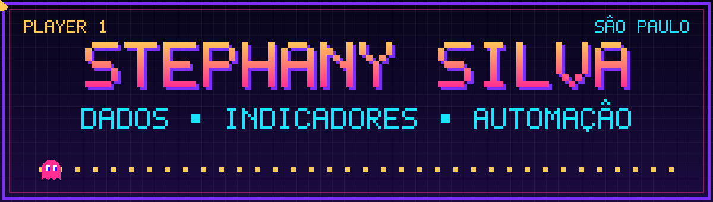
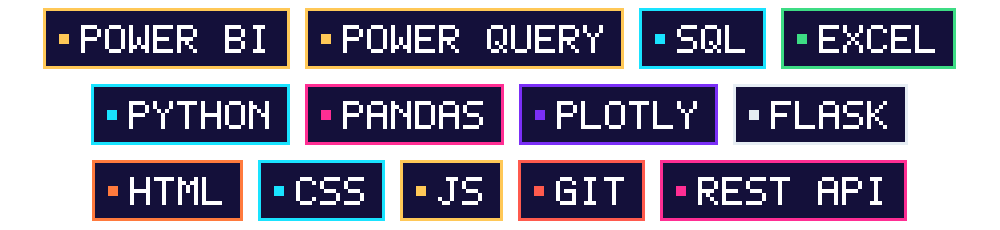
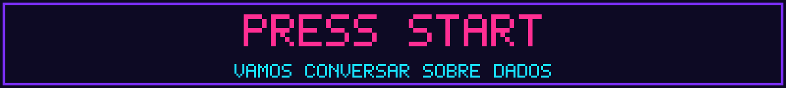

<div align="center">



<br>

<a href="https://linkedin.com/in/stephany-silva23"></a>
<a href="mailto:sstephany683@gmail.com"></a>

</div>

<br>

## `perfil.sql`

```sql
SELECT
    nome        AS 'Stephany Silva',
    foco        AS 'Análise de dados e indicadores',
    ferramentas AS 'Power BI, SQL, Python, Excel',
    formacao    AS 'ADS, conclusão em 2027',
    experiencia AS 'Operação de campo e Trade Marketing',
    status      AS 'Construindo portfólio de dados'
FROM stephany_silva
WHERE disponibilidade = 'aberta';
```

<br>

## `stack`

<div align="center">

</div>

<br>

## `projetos`

<table>
  <tr>
    <td width="50%" valign="top">
      <h3><a href="https://github.com/pinkkk683/Inquilinos_control">Gestão de Inquilinos</a></h3>
      <p>Sistema web com banco de dados, consultas SQL, autenticação e relatórios financeiros.</p>
      
    </td>
    <td width="50%" valign="top">
      <h3><a href="https://github.com/pinkkk683/conversor-de-moedas">Conversor de Moedas</a></h3>
      <p>Conversão em tempo real entre BRL, USD e EUR consumindo uma API REST.</p>
      
    </td>
  </tr>
</table>

<br>

## `atividade`

<div align="center">


<br><br>


</div>

<br>

## `em andamento`

- Bootcamp Bradesco GenAI & Dados (conclusão em janeiro de 2027)
- Novos projetos de dados, publicados aqui

<br>

<div align="center">

</div>
